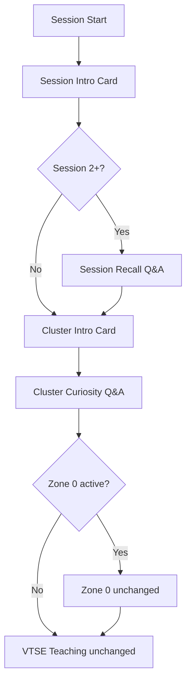

# PHASE PEDAGOGY-2 — Session Recall + Cluster Curiosity

## Scope (additive only)

New pre-teach layers inserted **after** intro cards, **before** existing Zone 0 / VTSE teaching. Locked systems were not modified except:

- Minimal orchestration gate in `pedagogy_intro_service.py` (defer cluster intro until recall completes)
- `session_service.py` pedagogy intercept chain (additive calls)
- Zone 3 placeholder message in `zone_transition_coordinator.py` (target == 3 only)

## Architecture

## Runtime state machine

| flow_state | Input | Next |
|------------|-------|------|
| `pedagogy_session_intro` | TTS done → `session_intro_done` | Recall or cluster intro |
| `pedagogy_session_recall` | Student chat answer | `session_recall_feedback` |
| `pedagogy_session_recall_feedback` | TTS done → `session_recall_done` | Cluster intro |
| `pedagogy_cluster_intro` | TTS done → `cluster_intro_done` | Cluster curiosity |
| `pedagogy_cluster_curiosity` | Student chat answer | `cluster_curiosity_feedback` |
| `pedagogy_cluster_curiosity_feedback` | TTS done → `cluster_curiosity_done` | Zone 0 / VTSE |

## Files changed

### Created
- `backend/app/services/pedagogy/pedagogy_recall_curiosity_service.py`
- `backend/tests/pedagogy/test_pedagogy_recall_curiosity_service.py`

### Modified (additive)
- `backend/app/models/learning/sessions.py` — recall/curiosity fields
- `backend/app/services/pedagogy/pedagogy_intro_service.py` — recall gate before cluster intro
- `backend/app/services/session_service.py` — intercept chain + board persist types
- `backend/app/services/progression/zone_transition_coordinator.py` — Zone 3 placeholder
- `frontend/lib/tutorFlow.ts`, `types.ts`, `api.ts`, `useChat.ts`, `sessionRestore.ts`, `zone0Chat.ts`
- `frontend/app/(app)/learn/[topicId]/page.tsx` — TTS auto-advance for feedback stages

## Runtime events added

| Response type | Purpose |
|---------------|---------|
| `session_recall_prompt` | Recall question on whiteboard |
| `session_recall_feedback` | Eval + recap bullets |
| `cluster_curiosity_prompt` | Curiosity question |
| `cluster_curiosity_feedback` | Warm appreciation + transition |

Actions: `__action:session_recall_done`, `__action:cluster_curiosity_done`

## Restore behavior

- Session fields persist stage + questions: `pedagogy_recall_stage`, `pedagogy_curiosity_stage`, `pedagogy_*_question`
- Done flags: `pedagogy_session_recall_done`, `pedagogy_cluster_curiosity_done_for`
- Board turns persist with new `response_type` values
- `flow_state` restored from backend; mid-stage resume continues same layer

## TTS behavior

- Reuses existing `WordSyncedStreaming` on whiteboard prose
- Recall/curiosity **prompts**: TTS reads question; student replies in chat
- **Feedback** stages: TTS reads eval/recap or appreciation; auto-sends done action after TTS (same pattern as intro cards)

## QA checklist

### Scenario 1 — Session 1
- Session Intro → Cluster Intro → Curiosity → Teaching/Zone 0
- No session recall

### Scenario 2 — Session 2+
- Session Intro → Session Recall → Cluster Intro → Curiosity → Teaching

### Scenario 3 — Zone 1 cluster
- Curiosity → existing VTSE flow

### Scenario 4 — Zone 2 cluster
- Curiosity → same VTSE engine as Zone 1

### Scenario 5 — Zone 2 clarity gate pass
- Placeholder: "Zone 3 is not implemented yet."

## Regression proof (unchanged)

| System | Status |
|--------|--------|
| Zone 0 handler | Not modified |
| Zone 1 VTSE | Not modified |
| Concept checks / notes | Not modified |
| Cluster quiz / teachback | Not modified |
| Clarity gate evaluation | Not modified |
| Session progression | Not modified |
| RAG retrieval | Not modified |
| Intro cards | Not modified (orchestration gate only) |
