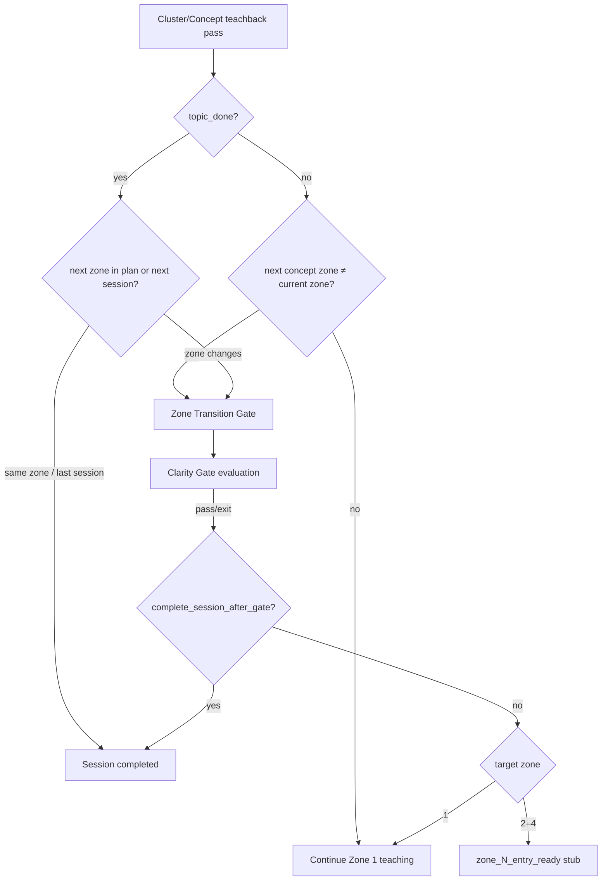

# Zone Architecture Unification — Implementation Report

## 1. Architecture Before

```
Topic
 ├─ Full Topic Path (legacy)
 │    Zone 0 → Zone 1 → Clarity Gate (topic end) → post_learning (Zones 2–4 LLM chat)
 │    → adaptive zone promotion → completed
 │
 └─ Session Plan Path (classroom)
      Zone 0 → Zone 1 → skip Clarity Gate → completed → unlock next session
```

**Problems:** dual runtime paths, Clarity Gate tied to topic completion, `post_learning` implemented old Zones 2–4, planned sessions bypassed the gate entirely.

---

## 2. Architecture After

```
Topic
 ↓
Structured Curriculum (v2 manifest)
 ↓
Teacher/Admin Session Planning (ClassSessionPlan)
 ↓
Student Runtime (progression_session_plan_id required)
 ↓
Zone 0  [untouched]
 ↓
Zone 1  [untouched — VTSE, concept Q, cluster quiz/teachback]
 ↓
Zone Transition Gate (Clarity Gate)  — only when current_zone ≠ target_zone
 ↓
Zone 2 entry stub (zone_2_entry_ready)
 ↓
Zone Transition Gate
 ↓
Zone 3 entry stub
 ↓
Zone Transition Gate
 ↓
Zone 4 entry stub
 ↓
Topic Complete (all planned sessions + final zone)
```

**Single path.** No `post_learning`. No full-topic vs session-plan branching.

---

## 3. Runtime Branches Removed

| Removed | Location |
|---------|----------|
| `post_learning` flow state + handler | Deleted `post_learning_handler.py`; removed dispatch in `session_service.py` |
| Full-topic Clarity Gate at concept end | `teachback_handler.py` per-concept completion |
| Session-plan Clarity Gate skip | `cluster_teachback_orchestrator.py` |
| `use_post_learning=True` after gate pass | `teachback_handler._handle_clarity_gate` |
| Teacher skip → `post_learning` | `explanation_handler.teacher_advance_skip` |
| Old Zone 2–4 LLM deepening | `post_learning_handler.py` (deleted) |
| Adaptive zone promotion engine | `post_learning_handler.py` (deleted) |
| `zone2_depth` assignment on gate pass | Removed from gate completion path |

---

## 4. Files Changed

### Backend (new)
- `app/services/progression/zone_transition_coordinator.py`
- `tests/progression/test_zone_transition_coordinator.py`

### Backend (modified)
- `app/models/learning/sessions.py` — zone transition fields, flow_state enum
- `app/services/handlers/cluster_teachback_orchestrator.py`
- `app/services/handlers/teachback_handler.py`
- `app/services/handlers/explanation_handler.py`
- `app/services/session_service.py`

### Backend (deleted)
- `app/services/handlers/post_learning_handler.py`

### Frontend (modified)
- `lib/api.ts` — `zone_2/3/4_entry_ready` response mapping
- `lib/tutorFlow.ts` — zone entry flow states, removed `post_learning`
- `lib/types.ts` — TutorResponse union for zone entry types

---

## 5. Zone Transition Flow



**Coordinator:** `ZoneTransitionCoordinator.decide_after_cluster_teachback()`  
**Gate start:** `begin_gate()` — sets `clarity_gate_active`, `zone_transition_*` fields  
**Gate end:** `complete_gate()` — advances `current_zone`, returns entry stub or `completed`

---

## 6. Clarity Gate Flow

- **Trigger:** `target_zone != from_zone` only (never topic-end-only).
- **Implementation:** unchanged `_handle_clarity_gate()` evaluation (LLM + SUS guards).
- **On pass:** `complete_gate()` → `teachback_passed` | `zone_N_entry_ready` | `completed`.
- **On max rounds:** graceful `clarity_gate_exit` message, still calls `complete_gate()`.
- **Session fields:** `zone_transition_from_zone`, `zone_transition_target_zone`, `zone_transition_complete_session`.

---

## 7. Runtime Entry Points for Zones 2–4

| Zone | flow_state | Response type | Behavior |
|------|------------|---------------|----------|
| 2 | `zone_2_entry` | `zone_2_entry_ready` | Stub — no teaching, no old reflective chat |
| 3 | `zone_3_entry` | `zone_3_entry_ready` | Stub |
| 4 | `zone_4_entry` | `zone_4_entry_ready` | Stub |

Frontend disables main input in zone entry states until Zone 2–4 are built.

---

## 8. Regression Verification (Zone 0 & Zone 1 Untouched)

| Suite | Result |
|-------|--------|
| `tests/progression/test_zone_transition_coordinator.py` | 4/4 pass |
| `tests/integration/test_zone0_flow.py` | pass (no changes to `zone0_handler.py`) |
| Zone 1 handlers (`explanation_handler` VTSE path, `cluster_teachback_orchestrator` scoring) | no logic changes inside gate evaluation or VTSE pipeline |

**Not modified:** Zone 0 handler, VTSE authoring, concept questions, concept notes, cluster quiz, cluster teachback scoring tiers, timeline/whiteboard/renderer, manifest resolution, session planning, progression engine, release policy.

---

## 9. QA Steps

### Session ending after Zone 1 only
1. Create plan: Session 1 = Zone 1 clusters only; Session 2 = Zone 2.
2. Student completes Session 1 (cluster teachback on last cluster).
3. **Expect:** Clarity Gate prompts Zone 1 synthesis.
4. Pass gate → **Expect:** `type: completed`, session ends, Session 2 unlocks.

### Zone transition inside a session
1. Create plan: Session 1 = Zone 1 cluster A + Zone 2 cluster A.
2. Complete Zone 1 cluster teachback.
3. **Expect:** Clarity Gate (not session complete).
4. Pass gate → **Expect:** `zone_2_entry_ready`, `flow_state: zone_2_entry`, session still active.

### Clarity Gate execution
1. During gate, verify `meta.clarity_gate` / teachback mode in UI.
2. Submit multi-concept explanation.
3. **Expect:** coverage scoring unchanged; pass advances zone or completes session per plan.

### No old post_learning runtime
1. Grep/runtime: `flow_state` never becomes `post_learning`.
2. After gate pass into Zone 2, **Expect:** stub message, not reflective LLM chat loop.
3. `POST /sessions/ask` with former post_learning session → normal teachback/idle routing.

### No dual-path architecture
1. All launches must set `progression_session_plan_id`.
2. Session without plan ID → coordinator raises; runtime falls back to `completed` only at slice end.
3. No branch on “full topic” vs “planned session” in teachback handlers.

---

*Generated: Phase Zone Architecture Unification implementation.*
